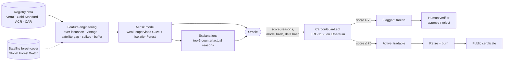
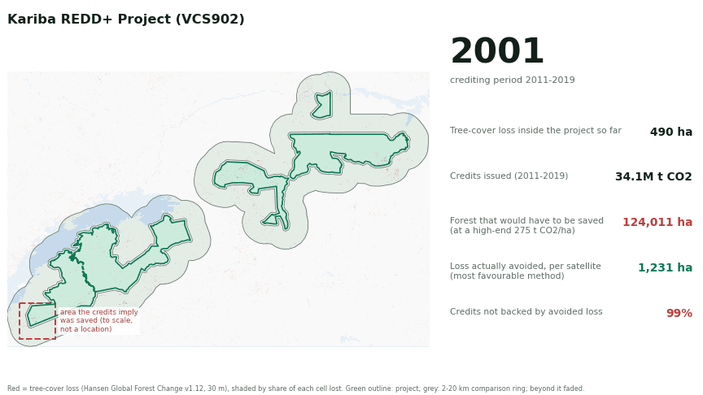

# CarbonGuard

**Every tonne scored by AI. Every tonne counted once.**

[](https://github.com/raycon0009/carbonguard/actions/workflows/ci.yml)  

CarbonGuard is a quality gate for carbon credits. An explainable AI model scores every credit batch for over-crediting and fraud risk. A smart contract then freezes high-risk batches before they reach buyers and makes **double tokenisation, double selling and double claiming impossible** at the protocol level. Every retirement produces a public certificate that anyone can verify, and it records which AI model judged the credit.

> Track: **Carbon Markets & Emissions Transparency** · IEEE ClimateChain Global Hackathon

---

## The problem

Carbon markets only work if one credit really equals one tonne of CO₂, counted once. Today neither holds reliably:

| Failure | Evidence |
|---|---|
| **Over-crediting / phantom credits** | West et al. (*Science*, 2023) found most sampled REDD+ rainforest projects did not reduce deforestation as claimed. A Guardian / Die Zeit / SourceMaterial investigation (2023) concluded that the large majority of Verra rainforest credits were likely "phantom credits". |
| **Inflated cookstove claims** | Gill-Wiehl et al. (*Nature Sustainability*, 2024) estimated cookstove projects were over-credited roughly nine-fold. |
| **Low overall integrity** | Probst et al. (*Nature Communications*, 2024) estimated that fewer than 16% of the credits they assessed represent real emission reductions. |
| **Double tokenisation** | In 2022, crypto bridges tokenised millions of old registry credits. Verra responded by banning the tokenisation of retired credits because of double-counting risk. |
| **Double claiming** | Under Paris Agreement Article 6 (rules finalised at COP29, 2024), a credit used for a compliance claim needs the host country to make a *corresponding adjustment*. Without one, both the country and the buyer count the same tonne. |

Verification is slow, manual and opaque, so buyers can't tell good credits from bad ones and trust in the whole market drops.

## The solution



### 1. Explainable AI risk scoring (`ai/`)
- **Features** that registries already publish (or could): issuance against the project's own ex-ante estimate, vintage age, peak-year issuance spikes, retirement rate, permanence-buffer shortfall, auditor churn, project-type history, plus a **satellite forest-cover gap** (claimed vs. observed avoided deforestation), **measured from real satellite data** where the landscape allows it.
- **Weak supervision.** No public "fraud" labels exist, so seven labelling functions encode red flags from the research literature. They are combined Snorkel-style with a noisy-OR into a soft *P(suspicious)*.
- **Training data.** 420 synthetic projects (the only ones with ground truth and satellite evidence) plus **6,038 real registry projects** from the Berkeley database, with equal total weight per source. The 69 real projects used to judge the model are **held out of training**.
- **Model.** A gradient-boosting regressor generalises those weak labels, and an **IsolationForest** catches anomalies that no rule describes. Blended score = `round(100 · (0.8·GBM + 0.2·anomaly))`.
- **Explanations.** For each project, each feature is reset to a typical clean value and the drop in risk is measured. The top three drops become plain-English reasons, for example *"Issued 4.6x its own ex-ante estimate"* or *"Satellite shows 77% less avoided forest loss than claimed"*. When several red flags saturate the score, the abnormal features it relies on together are cited. These reasons are written **on chain** next to the score.
- **Provenance.** The SHA-256 of the model file and of all training data are stored with every score, so anyone can audit which model judged which credit.

**Results** on the synthetic test set (420 projects, 5-fold out-of-fold scoring):

| Metric | Value |
|---|---|
| ROC-AUC vs. hidden ground truth, CarbonGuard | **0.977** |
| ROC-AUC vs. hidden ground truth, red-flag rules alone | 0.929 |
| Precision of the High tier | **98.2%** |
| Problem projects caught (Medium or High) | **98.1%** |

These numbers are on synthetic data. The three real-world tests below are the honest measure, including where the model fails.

### Real-world validation
All 6,107 real projects with issued credits in the [Berkeley Voluntary Registry Offsets Database](https://gspp.berkeley.edu/berkeley-carbon-trading-project/offsets-database) (v2026-08) are scored. Registries don't publish satellite data or auditor history; where we have no measurement, those inputs get neutral values that can only lower a score. Results: `ai/real_world/`.

| Result | Value |
|---|---|
| Real projects rated High (would be frozen) | 143 (2.3%) |
| Rated Medium (warning) | 1,217 (19.9%) |
| Share of REDD+ tonnes rated Medium or High | 53%, against ~94% found not real in West et al. (*Science*, 2023), a different sample |

#### Test 1: real satellite data (`ai/satellite/`)
For four REDD+ projects with **official registry boundaries** ([Karnik et al. 2024](https://zenodo.org/records/11459391)), we measured real forest loss from **Hansen Global Forest Change** (30 m satellite data, 2001–2024). We compared each project with a 2–20 km ring around it, before and during its crediting period, and then compared the deforestation it actually avoided with the credits it was issued. Two standard counterfactuals are computed (before/after, and "would have been cleared like its surroundings"), and the one **more favourable to the project** is used. Carbon densities are high-end IPCC defaults, which also favour the project.

| Project | Credits not backed by avoided forest loss | Most its credits could be backed, even if it had stopped *all* expected loss | Score: registry data only → with satellite |
|---|---|---|---|
| **Kariba REDD+** (Zimbabwe, VCS902) | **99%** | 3.7% | 6 → **64 Medium** |
| **Alto Mayo** (Peru, VCS944) | **77%** | 36% | 66 → **86 High (frozen)** |
| **Southern Cardamom** (Cambodia, VCS1748) | **59%** | 45% | 33 → **80 High (frozen)** |
| Kasigau Corridor II (Kenya, VCS612) | *not measurable* | n/a | 13 (unchanged) |

- **Kariba** is the project where Verra's own review found [15.2M excess credits out of 26.8M issued](https://verra.org/verra-acts-on-kariba-project-cancels-excess-credits-advances-independent-review/). Satellites recorded only about 600 ha of forest loss a year across its 1.07M ha, before and during the project, alike inside and outside it. Its 34M t of credits imply it prevented about 1.3% of the area being cleared every year, 20× more deforestation than was ever observed there. On registry data alone CarbonGuard scored it 6. With real satellite evidence it scores 64: a warning, but short of the freeze threshold, because the satellite gap is its only red flag.
- **Southern Cardamom and Alto Mayo** were barely deforested even before they started, while their surroundings were. That is the classic "baseline borrowed from a more threatened area" pattern.
- **Kasigau is dry bushland.** The satellite product tracks trees over 5 m and detected only 71 ha of loss there before the project began. A measurement only counts with at least 1,000 ha of detected pre-project loss, so Kasigau is reported as not measurable instead of being penalised.
- **Limits:** a ring is a simpler control than the synthetic-control matching used by West et al., the satellite product can miss slow degradation of dry woodland, and boundaries are as published. These are screening estimates, not audits.

**See it.** `web/satellite.html` animates the real forest-loss pixels year by year for each measured project, next to the forest the credits imply was saved, drawn to scale (`npm run map` regenerates it from the cached satellite data). Each map cell is shaded by the *share* of its land that was lost, so the map never exaggerates loss.



#### Test 2: graded against published verdicts (`ai/grade_california.py`)
[Badgley et al. (2021)](https://doi.org/10.1111/gcb.15943) estimated over-crediting for **65 California forest-offset projects** (data: CarbonPlan, CC BY 4.0). All 65 were held out of training, and the grading rule was fixed before looking: *over-credited* means over-credited even at the study's most favourable (5th-percentile) estimate, which is 45 of 65.

**Result: CarbonGuard is no better than chance here (AUC 0.56, rank correlation 0.00).** California's over-crediting came from how each project's baseline carbon stock was set (regional averages that didn't fit the actual forest). That leaves no trace in registry issuance data, which is all the model sees for these projects. Like Kariba before satellite data, it needs outside evidence, here forest-inventory data.

#### What this means
Registry data alone catches over-issuance, spikes, thin buffers and non-additional project types. **Inflated baselines, the biggest documented problem, need outside evidence.** Satellite data turned two missed REDD+ projects into freezes and lifted a third from 6 to 64. Expanding satellite measurement and adding forest-inventory data are the top roadmap items.

Scores are statistical risk indicators from public data, not allegations of wrongdoing. Data: Quartson, Haya, Bernard, Abayo, Rong, So, Elias (2026), *Voluntary Registry Offsets Database v2026-08*, Berkeley Carbon Trading Project, UC Berkeley, CC BY 4.0; Hansen et al. (2013), *Science* 342:850, Global Forest Change v1.12, CC BY 4.0; Karnik et al. (2024), Zenodo 11459391, CC BY 4.0; Badgley et al. (2021), *Global Change Biology* 28:1433; carbon densities from Rozendaal et al. (2022), *Environ. Res. Lett.*

### Responsible AI
- **Country is never a model input.** A test moves every project to another country and checks that no score changes.
- **No hidden regional bias.** `ai/fairness.py` compares each region's High rate with what its project-type mix alone predicts. The largest unexplained gap is **1.4 points** on the synthetic set and **3.7 points** across the 6,107 real projects. Charts: `ai/charts/fairness_by_region.png`, `ai/charts/fairness_real_world.png`.
- **A human in the loop for every freeze.** The AI can only freeze. Unfreezing takes `requiredApprovals` independent verifiers (2-of-3 in the demo).
- **Intended use:** a screening tool that prioritises credits for human review, not a verdict. **Limits:** labels are weak (expert rules, not ground truth), and inflated baselines are invisible without outside evidence (see the satellite and California results).

### Impact and cost
- The dashboard turns blocked tonnes into everyday terms: cars driven for a year ([EPA: 4.6 tCO₂ per car](https://www.epa.gov/greenvehicles/greenhouse-gas-emissions-typical-passenger-vehicle)) and dollars kept from buyers. That uses an **assumed** $3.50/t, the low-rated credit price, because these are junk credits. Constants live in `web/impact.js`.
- Gas is **measured** for every action (`npm run gas` writes [`docs/costs.md`](docs/costs.md)). Retiring credits uses about 289k gas, **under one cent on Base**, and costs the same for 1 tonne or 1 million. Dollar figures assume ETH = $3,000, 0.01 gwei on Base (L1 data fee excluded) and 2 gwei on mainnet.

### 2. Smart contract (`contracts/CarbonGuard.sol`)
An ERC-1155 token in which **one token id = one project-vintage batch and one token = 1 tCO₂e**. Access control has a `REGISTRY_ROLE` (bridging), an `ORACLE_ROLE` (AI scores) and a `VERIFIER_ROLE` (human review).

| Guard | How it's enforced |
|---|---|
| **Double tokenisation** | Each registry serial range is stored per (registry, project, vintage). Any exact *or partial* overlap reverts with `AlreadyTokenized(existingId, overlapFrom, overlapTo)`. The token amount is derived from the serials, so it can't be inflated. |
| **Junk credits** | Batches start out `Pending`. An AI score above 70 makes the batch `Flagged`, and the `_update` hook blocks every transfer and retirement until the verifier panel decides. A rejection is permanent. **The AI can only tighten:** re-scoring with a newer model can freeze an active batch, but only humans can unfreeze a flagged one. |
| **No single point of trust** | A decision needs `requiredApprovals` matching votes from independent `VERIFIER_ROLE` holders (2-of-3 in the demo). Each verifier votes once (`AlreadyVoted`), and every vote is an on-chain event. |
| **Double selling** | `retire()` burns tokens, so a retired tonne no longer exists to sell or retire again. |
| **Double claiming** | `retire(..., complianceClaim=true)` reverts with `NoCorrespondingAdjustment` unless the batch carries an Article 6 corresponding adjustment. |
| **Transparency** | Every retirement stores the beneficiary, purpose, amount, claim type, **risk score at retirement and model hash**, and emits an event the certificate page reads. |

**Trading venues inherit the gate (`contracts/CarbonMarket.sol`).** An example marketplace with fixed-price listings paid in ETH. Frozen credits can't be listed. If a batch is frozen *after* listing (for example, when a new satellite measurement re-scores it), the listing is suspended and can't be bought until verifiers approve the batch again. Sellers keep custody until a sale and collect payment with `withdraw()` (pull payments, re-entrancy guarded). Even a marketplace without these checks couldn't sell frozen credits: CarbonGuard's own transfer gate would revert.

**84 contract and integration tests · 100% statement, branch, function and line coverage** (`npx hardhat coverage`). See [How we know it works](#how-we-know-it-works).

### 3. Dashboard (`web/`)
Static HTML with ethers.js. No backend and no build step, and it reads directly from the chain.
- KPIs: tonnes tokenised, retired, **blocked as high-risk** and tradable.
- **Attack simulator.** Three buttons try to cheat the market against the live contract, with no wallet needed, and show the exact revert.
- A credit table with the AI score, the reasons and the status. Click a row to see serials, hashes and retirements.
- **Impact strip**: blocked tonnes as cars per year and dollars, plus the measured cost of a retirement.
- **Real-world check** card (Kariba and three other REDD+ projects measured with real satellite data) and a **Responsible AI** card (regional bias check).
- **Marketplace** card: listings with live status. A listing whose credits get frozen shows *Suspended*, and Buy is disabled.
- With a wallet you can buy and retire credits, cast a verifier vote ("1 of 2 approvals"), and open the **public retirement certificate** (`certificate.html?id=N`).
- **Pre-check a project** (`sandbox.html`): pick a real project (Kariba, Alto Mayo…) or type in your own registry data, and the **same model** scores it live in your browser, with the reasons it would write on chain. Drag the satellite-gap slider and watch Kariba go from 6 to 64. The model is exported to JavaScript (`ai/web_model.py`, `web/scorer.js`), and nothing you type leaves the page or goes on chain.
- **Satellite evidence** (`satellite.html`): the animated forest-loss map described above.

---

## Run it locally (about 5 minutes)

Prerequisites: Node 18+ and Python 3.10+ (`pip install -r ai/requirements.txt`).

```bash
npm install
npm run score          # generate dataset, train model, write scores + hashes
npm run test:all       # AI tests + contract tests + release checklist
npm run chain          # terminal 1: local blockchain
npm run demo:local     # terminal 2: deploy -> push AI scores on chain -> seed demo history
npm run web            # open http://localhost:8080
npm run demo:monitor   # optional, live: a satellite re-score freezes Alto Mayo and suspends its listing
```

To use the wallet features locally, import Hardhat account #0 into MetaMask. Its private key is printed by `npm run chain`, is public, and is for local testing only. The dashboard adds the Hardhat network to MetaMask for you.

## How we know it works

**84 contract and integration tests** (Hardhat) plus **54 AI pipeline tests** (pytest) run on every push in CI, alongside the [Slither](https://github.com/crytic/slither) static analyser and a release checklist.

| Claim | Proven by |
|---|---|
| A credit can't be tokenised twice, even partially | `test/CarbonGuard.test.js` › *Bridging & double tokenisation*; `test/CarbonGuard.security.test.js` › *Serial range edge cases* |
| A retired tonne can never be sold or retired again | `CarbonGuard.test.js` › *a retired tonne can never be retired or sold again* |
| Only a human can unfreeze a flagged credit, not the oracle | `CarbonGuard.security.test.js` › *the oracle cannot unfreeze a Flagged batch by re-scoring it low* |
| No single verifier can unfreeze a credit | `test/CarbonGuard.verifiers.test.js`: one vote isn't enough, nobody can vote twice, and only `VERIFIER_ROLE` holders can vote; the fuzz test runs with a 2-verifier panel |
| The gate can't be bypassed (operators, batch transfers, pending, rejected) | `CarbonGuard.security.test.js` › *Quality gate covers every path* |
| No tonne is ever created, duplicated or lost | `test/CarbonGuard.invariants.test.js`: 300 random actions from random wallets, with conservation, no-overlap and freeze invariants checked after every step |
| What's on chain is exactly what the AI produced | `test/pipeline.integration.test.js`: scores, reasons and both hashes match the model output for every batch |
| Python, the dashboard and Solidity agree on "high risk" | `pipeline.integration.test.js` › *Python, JavaScript and Solidity agree*; `ai/tests` › tier-boundary tests |
| Judges see a sentence, never a raw revert | `pipeline.integration.test.js` › every contract error has a dashboard message, and all 3 attack-simulator calls are replayed |
| The model is reproducible and its hash identifies it | `ai/tests` › *two runs are byte-identical*, *checked-in hashes match*, *fresh clone regenerates the published dataset* |
| The model never sees the answer | `ai/tests` › *ground truth is never a model input* |
| Explanations are honest | `ai/tests` › *every cited reason points at an abnormal value* |
| It behaves sensibly | `ai/tests` › more over-issuance or a bigger satellite gap never lowers risk; fixing the red flags lowers it |
| Gaming the rules doesn't work | `ai/tests` › *dodging every rule does not dodge the model*: a REDD+ project kept just under all six red-flag thresholds is still flagged (Medium; it scored High before real projects were added to training) |
| It's not overfit to one dataset | `ai/tests` › retrained on 3 freshly generated markets, AUC ≥ 0.9 and High-tier precision ≥ 85% each time |
| It works on real data, and we say where it doesn't | `ai/tests/test_real_world.py`: the registry mapping, the neutral fill-ins, reproducing all 6,107 published scores from the committed data, and every judged project held out of training |
| Satellite measurements are sound | `ai/tests/test_satellite.py`: known answers for a project that changed nothing, one that stopped deforestation, over-crediting, a regional slowdown, the two counterfactuals, and landscapes the satellite can't see |
| Satellite evidence counts on its own | `ai/tests` › *satellite evidence alone raises risk* (the Kariba lesson) |
| No regional bias | `ai/tests/test_fairness.py`: moving projects to another country changes nothing, and no region's unexplained gap is over 10 points |
| The browser sandbox is the same model as on chain | `test/sandbox.parity.test.js`: the JavaScript port reproduces the Python score **and reasons** for all 6,107 real projects exactly, and its model hash matches the model card |
| Nothing typed into the sandbox leaves the browser | `sandbox.parity.test.js` › no network, storage or wallet APIs in the sandbox page, and it only loads local scripts |
| The satellite map shows the measured numbers | `ai/tests/test_satellite_map.py`: downsampling keeps every lost pixel, cells are shaded by share lost (never "any loss"), and the frames the browser draws reproduce the full-resolution 30 m record |
| A marketplace can't sell frozen credits | `test/CarbonMarket.test.js`: listing refused for pending, flagged and rejected batches; a listing frozen after listing can't be bought until verifiers approve; exact payment; re-entrancy attempts from buyer and seller contracts fail |
| Cost claims stay true | `pipeline.integration.test.js` › *cost and impact claims*: gas budgets, published costs measured on the current contract, sourced impact constants |

```bash
npm run test:ai          # AI pipeline (about 30 s)
npm test                 # contracts, invariants, AI -> chain integration
npm run coverage         # 100% coverage report
npm run check            # secrets, licence, hashes, README counts
npm run satellite        # measure real satellite data (needs ai/requirements-satellite.txt + downloads)
npm run build:real       # rebuild ai/data/real_projects.csv from the Berkeley workbook
npm run validate:real    # score all real projects (uses the committed CSV)
npm run grade            # grade against the California verdicts
npm run gas              # re-measure gas and regenerate docs/costs.md
npm run map              # rebuild the satellite map + GIFs from cached satellite data
npm run export:web       # re-export the model to the browser sandbox (also done by npm run score)
```

`FUZZ_STEPS=2000 FUZZ_SEED=7 npx hardhat test test/CarbonGuard.invariants.test.js` runs a longer randomized campaign.

## Project structure

```
ai/generate_data.py        dataset generator (registry schema + documented failure archetypes)
ai/train_and_score.py      weak supervision, model, explanations, hashes, charts
ai/model/model_meta.json   model card: hashes, metrics, feature importance
contracts/CarbonGuard.sol  the contract
contracts/CarbonMarket.sol example marketplace that inherits the quality gate
ai/web_model.py            exports the model to web/sandbox_model.js for the browser sandbox
ai/satellite/              boundaries, satellite measurement, animated map (make_map.py)
test/                      Hardhat tests: unit, security, invariant fuzzing, AI -> chain integration
ai/tests/                  pytest suite for the AI pipeline
scripts/check_release.js   pre-publish checklist (npm run check)
scripts/deploy.js          deploy and write web/deployment.js
scripts/oracle_push_scores.js   AI -> chain bridge (oracle)
scripts/seed_demo.js       demo history, marketplace listings and guard checks
scripts/monitor_satellite.js   live demo: satellite re-score freezes a listed batch
web/                       dashboard, sandbox, satellite map and certificate
docs/                      demo script and pitch outline
```

## Honest limitations, and the path to production

- **Data.** Training combines 420 **synthetic** projects (the `_archetype` ground-truth column is used **only** for evaluation, never as an input) with 6,038 real registry projects. Satellite measurements cover four projects so far, and the California grading shows registry data can't detect baseline-setting problems. Next steps: satellite measurement for every forest project with a published boundary, and forest-inventory data for improved forest management projects.
- **Labels.** Weak labels encode expert knowledge, so the model can inherit its blind spots. The anomaly detector and human review exist to cover that.
- **Oracle trust.** The oracle is currently a single key. In production it would be Chainlink Functions or a multi-signer oracle that recomputes the score from the published model hash.
- **Registry link.** Bridging is authorised by `REGISTRY_ROLE`. Ideally the registry itself holds that role, and the off-chain serials are cancelled at the moment they are bridged.
- **Scale.** Deploy on an Ethereum L2 (Base, Arbitrum, Polygon) for low fees. The contract is chain-agnostic.

## Who would use this

- **Registries and bridges** (Verra, Gold Standard, Toucan-style bridges): run the AI gate and serial-range uniqueness before tokenising.
- **Corporate buyers**: screen credits before purchase and publish verifiable retirement certificates in ESG reports.
- **National Article 6 registries**: enforce corresponding adjustments and avoid double claiming between NDCs and corporate claims.
- **Auditors and journalists**: query every score, reason and model hash on chain.

## License
MIT
